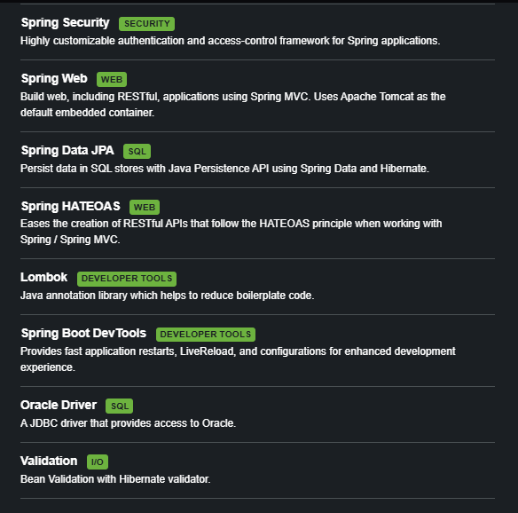

# BlackMarket — Mercado Express

Aplicação desenvolvida em **Spring Boot (Maven)** para uma empresa do tipo **mercado express** (meias, produtos de limpeza, frutas, etc.), com CRUD completo integrado ao banco de dados **Oracle FIAP**.

O projeto contempla:
- **Parte 1** — API REST pura (Postman/Insomnia), com HATEOAS.
- **Parte 2** — Interface Web (Spring MVC + Thymeleaf), com o mesmo CRUD acessível via navegador, protegida por Spring Security.

Projeto acadêmico — Checkpoint 4 — FIAP, Curso de Tecnologia em Análise e Desenvolvimento de Sistemas (TDS).

## 👥 Integrantes

- Pedro Ferreira Gomes — RM565824
- Jonas Santos — RM563234
- Gabriel Muller — RM561995

## 🚀 Tecnologias utilizadas

- Java 17
- Spring Boot 4.1.0
- Spring Web (MVC)
- Spring Data JPA
- Spring HATEOAS
- Spring Security
- Thymeleaf
- Bean Validation (Jakarta Validation)
- Lombok
- Oracle JDBC (ojdbc11)
- Maven
- Postman / Insomnia (testes da API)
- Docker (deploy)

## 🗄️ Modelagem no banco de dados

Tabela criada automaticamente via JPA/Hibernate (`ddl-auto=update`) no schema Oracle FIAP:

**Tabela:** `TDS_TB_MERCADO`

| Coluna    | Tipo    | Descrição                                                  |
|-----------|---------|-------------------------------------------------------------|
| ID        | NUMBER  | Chave primária (auto incremento)                            |
| NOME      | VARCHAR | Nome do produto                                              |
| DESCRICAO | VARCHAR | Descrição do produto                                         |
| PRECO     | NUMBER  | Preço do produto                                             |
| TIPO      | VARCHAR | Tipo do produto                                              |
| SETOR     | VARCHAR | Setor do mercado (ex: hortifruti, limpeza, higiene)          |
| TAMANHO   | NUMBER  | Tamanho/volume do produto                                    |
| CODE      | VARCHAR | Código único gerado automaticamente (ex: `PROD-XXXXXXXX`)    |

> Os campos `descricao` e `code` foram acrescentados aos exigidos no enunciado (`Id, Nome, Tipo, Setor, Tamanho, Preco`) para enriquecer o cadastro do produto. O `code` é gerado automaticamente pela entidade no evento `@PrePersist`/`@PreUpdate`, e não pode ser alterado manualmente em nenhuma atualização.

### Configuração da conexão (`application.properties`)

```properties
server.port=8082

spring.datasource.url=jdbc:oracle:thin:@oracle.fiap.com.br:1521:ORCL
spring.datasource.username=SEU_RM
spring.datasource.password=SUA_SENHA
spring.datasource.driver-class-name=oracle.jdbc.OracleDriver

spring.jpa.hibernate.ddl-auto=update
spring.jpa.show-sql=true
spring.jpa.database-platform=org.hibernate.dialect.OracleDialect

# usuario para login na interface web (Spring Security)
spring.security.user.name=admin
spring.security.user.password=admin123
```

---

## 📌 Parte 1 — API REST

Base URL local: `http://localhost:8082/mercado`

| Método | Endpoint                                   | Operação CRUD | Descrição                              |
|--------|---------------------------------------------|----------------|------------------------------------------|
| GET    | `/mercado`                                  | Read           | Lista todos os produtos cadastrados     |
| GET    | `/mercado/buscar-id-{id}`                   | Read           | Busca um produto específico pelo ID     |
| POST   | `/mercado`                                  | Create         | Cadastra um novo produto                |
| PUT    | `/mercado/atualizar`                        | Update         | Atualiza todos os dados de um produto   |
| PATCH  | `/mercado/atualizar-parcialmente-id-{id}`   | Update         | Atualiza campos específicos do produto  |
| DELETE | `/mercado/deletar-id-{id}`                  | Delete         | Remove um produto pelo ID               |

> A partir da Parte 2, o grupo de rotas `/mercado/**` passou a exigir autenticação (Spring Security). Ao testar via Postman/Insomnia, utilize **Basic Auth** com o usuário/senha definidos em `application.properties`.

### Testes via Postman / Insomnia

Todos os testes abaixo foram realizados com o servidor rodando localmente em `http://localhost:8082` (Tomcat embutido).

#### 1. GET — Listar todos os produtos
**Requisição:** `GET http://localhost:8082/mercado`

`[PRINT AQUI — request e response do GET /mercado no Postman/Insomnia]`

**Explicação:** o `MercadoController` chama `mercadoService.listaDeBrinquedos()`, que utiliza `mercadoRepository.findAll()` para consultar todos os registros da tabela `TDS_TB_MERCADO` e retorná-los em JSON.

#### 2. GET — Buscar produto por ID
**Requisição:** `GET http://localhost:8082/mercado/buscar-id-1`

`[PRINT AQUI — request e response do GET por ID]`

**Explicação:** o `id` é enviado via path variable. Caso o produto não exista, é lançada `EntidadeNaoEncontradaException`, tratada pelo `GlobalExceptionHandler` e retornada com status `404 Not Found`.

#### 3. POST — Criar novo produto
**Requisição:** `POST http://localhost:8082/mercado`

**Body (JSON):**
```json
{
  "nome": "Detergente Neutro 500ml",
  "descricao": "Detergente para louças, sem fragrância",
  "preco": 3.49,
  "tipo": "Limpeza",
  "setor": "Higiene e Limpeza",
  "tamanho": 0.5
}
```

`[PRINT AQUI — request com o body acima e response com o produto criado, incluindo id e code gerados]`

**Explicação:** o corpo é recebido via `@RequestBody` e mapeado para a entidade `Mercado`. Ao persistir, `prePersist()` gera automaticamente o `code` (ex: `PROD-12345678`), e o `id` é gerado pelo Oracle via `GenerationType.IDENTITY`.

#### 4. PUT — Atualizar produto (completo)
**Requisição:** `PUT http://localhost:8082/mercado/atualizar`

**Body (JSON):**
```json
{
  "id": 1,
  "nome": "Detergente Neutro 500ml",
  "descricao": "Detergente para louças - embalagem promocional",
  "preco": 2.99,
  "tipo": "Limpeza",
  "setor": "Higiene e Limpeza",
  "tamanho": 0.5
}
```

`[PRINT AQUI — request e response do PUT]`

**Explicação:** exige o `id` do produto existente. Se o campo `code` for informado no corpo, a API lança `ErrorDeParametroException` (400 Bad Request), já que o código não pode ser alterado manualmente.

#### 5. PATCH — Atualizar produto (parcial)
**Requisição:** `PATCH http://localhost:8082/mercado/atualizar-parcialmente-id-1`

**Body (JSON):**
```json
{
  "preco": 2.49
}
```

`[PRINT AQUI — request e response do PATCH]`

**Explicação:** apenas os campos enviados são atualizados; os demais permanecem inalterados (`MercadoService.atualizarParcialmente()`).

#### 6. DELETE — Remover produto
**Requisição:** `DELETE http://localhost:8082/mercado/deletar-id-1`

`[PRINT AQUI — request e response do DELETE]`

**Explicação:** o produto é localizado pelo `id` e removido via `mercadoRepository.delete()`. A API retorna `"Brinquedo deletado com sucesso!"` como confirmação.

#### 7. Tratamento de erros

`[PRINT AQUI — exemplo de erro 404 ao buscar um ID inexistente]`

`[PRINT AQUI — exemplo de erro 400 ao validar um campo obrigatório vazio, ex: nome em branco]`

**Explicação:** validações (`@NotBlank`, `@NotNull`) são aplicadas na entidade `Mercado`. Exceções de negócio (`EntidadeNaoEncontradaException`, `ErrorDeParametroException`) são centralizadas no `GlobalExceptionHandler`, retornando respostas HTTP padronizadas.

### 🔗 HATEOAS

A dependência `spring-boot-starter-hateoas` está incluída no projeto para suportar o padrão REST de nível de maturidade 3, adicionando links de navegação (`_links`) diretamente nas respostas JSON, permitindo que o cliente navegue pela API sem conhecer as URLs de antemão.

`[PRINT AQUI — response de um endpoint mostrando o campo "_links"]`

---

## 🖥️ Parte 2 — Interface Web (Spring MVC + Thymeleaf)

Além da API REST, o projeto conta com uma interface Web completa, construída com **Thymeleaf**, que consome a mesma camada de serviço/persistência da Parte 1 (mesmo banco Oracle FIAP) — permitindo listar, cadastrar, editar e excluir produtos diretamente pelo navegador.

Base URL local: `http://localhost:8082`

| Ação                          | Rota                          | Método    | Acesso            |
|--------------------------------|--------------------------------|-----------|-------------------|
| Página inicial                | `/firstpage`                  | GET       | Público           |
| Listar produtos                | `/produtos`                   | GET       | Público           |
| Visualizar / abrir edição      | `/produtos/{id}`              | GET       | Público           |
| Exibir formulário de cadastro  | `/produtos/novo`              | GET       | **Requer login**  |
| Cadastrar produto              | `/produtos/novo`              | POST      | **Requer login**  |
| Atualizar produto              | `/produtos/{id}/atualizar`    | POST      | **Requer login**  |
| Excluir produto                | `/produtos/{id}/deletar`      | POST      | **Requer login**  |

### 🔐 Segurança (Spring Security)

O projeto define rotas **públicas** (leitura: listar e visualizar produtos) e rotas **privadas** (escrita: criar, atualizar e excluir), exigindo autenticação via formulário de login (`formLogin`) para as ações de escrita.

Usuário de teste (definido em `application.properties`):
```
usuário: admin
senha:   admin123
```

### 🧭 Fluxo de telas

1. **`/produtos`** — tabela com todos os produtos cadastrados e botão **"+ Cadastrar novo produto"**.

   `[PRINT AQUI — tela de listagem de produtos]`

2. **`/produtos/novo`** — formulário de cadastro. Ao logar e salvar, o produto é gravado via `mercadoService.salvarBrinquedo()` e o usuário é redirecionado para a listagem.

   `[PRINT AQUI — formulário de cadastro de produto]`

3. **`/produtos/{id}`** — tela de detalhe do produto, que também serve como tela de edição: mostra o `code` (somente leitura) e os demais campos editáveis, com botões **Salvar alterações** e **Deletar produto** (com confirmação).

   `[PRINT AQUI — tela de visualização/edição de um produto]`

4. Após salvar ou excluir, o usuário retorna automaticamente para `/produtos`.

   `[PRINT AQUI — tela de login exigida ao tentar cadastrar/editar/excluir sem estar autenticado]`

---

## ⚙️ Variáveis de ambiente (produção)

| Variável                     | Descrição                                                |
|-------------------------------|-----------------------------------------------------------|
| `PORT`                        | Porta da aplicação (definida pela plataforma de deploy)  |
| `SPRING_DATASOURCE_URL`       | URL JDBC do banco Oracle FIAP                             |
| `SPRING_DATASOURCE_USERNAME`  | Usuário (RM) do banco                                     |
| `SPRING_DATASOURCE_PASSWORD`  | Senha do banco                                             |

## ▶️ Como executar localmente

```bash
git clone https://github.com/SEU-USUARIO/SEU-REPOSITORIO.git
cd SEU-REPOSITORIO
./mvnw spring-boot:run
```

A aplicação sobe em `http://localhost:8082`.
- API REST: `http://localhost:8082/mercado`
- Interface Web: `http://localhost:8082/produtos`

## 🐳 Como executar com Docker

```bash
docker build -t blackmarket .
docker run -p 8082:8082 \
  -e SPRING_DATASOURCE_URL="jdbc:oracle:thin:@oracle.fiap.com.br:1521:ORCL" \
  -e SPRING_DATASOURCE_USERNAME="SEU_RM" \
  -e SPRING_DATASOURCE_PASSWORD="SUA_SENHA" \
  blackmarket
```

## Login Spring

 - Usuário: `admin`
 - Senha: `admin123`

## ☁️ Deploy
 
A aplicação foi disponibilizada na plataforma **Render**, via Docker.

🔗 **Link da aplicação em produção:** `https://java-cp4.onrender.com/produtos`

🔗 **Repositório GitHub:** `https://github.com/2TDSPO-JPG/java_cp4.git`

🔗 **Link do Vídeo:** `https://youtu.be/XlL9iDfULJM`


### Como o deploy foi feito

1. Repositório publicado no GitHub com o `Dockerfile` na raiz do projeto.
2. Criado um **Web Service** no Render, ambiente **Docker**, apontando para o repositório.
3. Configuradas as variáveis de ambiente (`SPRING_DATASOURCE_URL`, `SPRING_DATASOURCE_USERNAME`, `SPRING_DATASOURCE_PASSWORD`) na aba **Environment** do Render.
4. Build e deploy automáticos a cada push na branch principal.

---

### Imagens



---

## 📄 Licença

Projeto acadêmico — uso livre para fins de estudo.