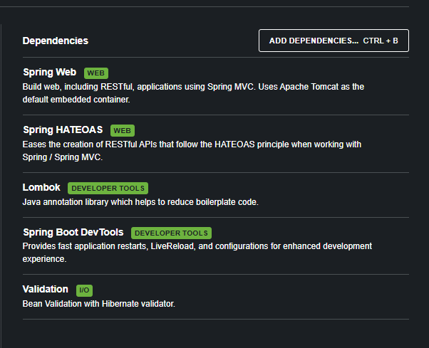

# BlackMarket API — Mercado Express

Aplicação desenvolvida em **Spring Boot (Maven)** para uma empresa do tipo **mercado express** (meias, produtos de limpeza, frutas, etc.), com CRUD completo integrado ao banco de dados **Oracle FIAP**, seguindo o padrão REST com boas práticas de tratamento de exceções.

Projeto acadêmico desenvolvido para a disciplina **[nome da disciplina/curso]** — FIAP.

## 👥 Integrantes

- Pedro Ferreira Gomes — RM565824
- Jonas Santos — RM563234
- Gabriel Muller — RM561995

## 🚀 Tecnologias utilizadas

- Java 17
- Spring Boot 4.1.0
- Spring Web (MVC)
- Spring Data JPA
- Spring HATEOAS
- Bean Validation (Jakarta Validation)
- Lombok
- Oracle JDBC (ojdbc11)
- Maven
- Postman / Insomnia (testes)
- Docker (deploy)

## 🗄️ Modelagem no banco de dados

Tabela criada automaticamente via JPA/Hibernate (`ddl-auto=update`) no schema Oracle FIAP:

**Tabela:** `TDS_TB_MERCADO`

| Coluna      | Tipo    | Descrição                         |
|-------------|---------|-------------------------------------|
| ID          | NUMBER  | Chave primária (auto incremento)   |
| NOME        | VARCHAR | Nome do produto                    |
| DESCRICAO   | VARCHAR | Descrição do produto               |
| PRECO       | NUMBER  | Preço do produto                   |
| TIPO        | VARCHAR | Tipo do produto                    |
| SETOR       | VARCHAR | Setor do mercado (ex: hortifruti, limpeza, higiene) |
| TAMANHO     | NUMBER  | Tamanho/volume do produto          |
| CODE        | VARCHAR | Código único gerado automaticamente (ex: `PROD-XXXXXXXX`) |

> Os campos `descricao` e `code` foram acrescentados aos exigidos no enunciado (`Id, Nome, Tipo, Setor, Tamanho, Preco`) para enriquecer o cadastro do produto. O `code` é gerado automaticamente pela entidade no evento `@PrePersist`/`@PreUpdate`.

### Configuração da conexão (`application.properties`)

```properties
server.port=8082

spring.datasource.url=jdbc:oracle:thin:@oracle.fiap.com.br:1521:ORCL
spring.datasource.username=SEU_RM
spring.datasource.password=SUA_SENHA
spring.datasource.driver-class-name=oracle.jdbc.OracleDriver

spring.jpa.hibernate.ddl-auto=update
spring.jpa.show-sql=true
spring.jpa.database-platform=org.hibernate.dialect.OracleDialect
```

## 📌 Endpoints da API (CRUD completo)

Base URL local: `http://localhost:8082/mercado`

| Método | Endpoint                                    | Operação CRUD | Descrição                              |
|--------|-----------------------------------------------|----------------|------------------------------------------|
| GET    | `/mercado`                                   | Read           | Lista todos os produtos cadastrados     |
| GET    | `/mercado/buscar-id-{id}`                    | Read           | Busca um produto específico pelo ID     |
| POST   | `/mercado`                                   | Create         | Cadastra um novo produto                |
| PUT    | `/mercado/atualizar`                         | Update         | Atualiza todos os dados de um produto   |
| PATCH  | `/mercado/atualizar-parcialmente-id-{id}`    | Update         | Atualiza campos específicos do produto  |
| DELETE | `/mercado/deletar-id-{id}`                   | Delete         | Remove um produto pelo ID               |

## 🧪 Testes via Postman / Insomnia

> Todos os testes abaixo foram realizados com o servidor rodando localmente em `http://localhost:8082` (Tomcat embutido).

### 1. GET — Listar todos os produtos

**Requisição:** `GET http://localhost:8082/mercado`

Retorna a lista de todos os produtos cadastrados no banco Oracle.

`[PRINT AQUI — request e response do GET /mercado no Postman/Insomnia]`

**Explicação:** ao acessar o endpoint, o `MercadoController` chama `mercadoService.listaDeBrinquedos()`, que por sua vez utiliza `mercadoRepository.findAll()` para consultar todos os registros da tabela `TDS_TB_MERCADO` e retorná-los em formato JSON.

### 2. GET — Buscar produto por ID

**Requisição:** `GET http://localhost:8082/mercado/buscar-id-1`

`[PRINT AQUI — request e response do GET por ID]`

**Explicação:** o `id` é enviado via path variable. O `MercadoService` consulta o produto no banco; caso não exista, é lançada a exceção `EntidadeNaoEncontradaException`, tratada pelo `GlobalExceptionHandler` e retornada com status `404 Not Found`.

### 3. POST — Criar novo produto

**Requisição:** `POST http://localhost:8082/mercado`

**Body (JSON):**
```json
{
  "nome": "Detergente Neutro 500ml",
  "descricao": "Detergente para louças, sem fragrância",
  "preco": 3.49,
  "tipo": "Limpeza",
  "setor": "Higiene e Limpeza",
  "tamanho": 0.5
}
```

`[PRINT AQUI — request com o body acima e response com o produto criado, incluindo id e code gerados]`

**Explicação:** o corpo da requisição é recebido pelo `@RequestBody` e mapeado para a entidade `Mercado`. No momento de persistir, o método `prePersist()` gera automaticamente o `code` do produto (ex: `PROD-12345678`), e o `id` é gerado pelo Oracle via `GenerationType.IDENTITY`.

### 4. PUT — Atualizar produto (completo)

**Requisição:** `PUT http://localhost:8082/mercado/atualizar`

**Body (JSON):**
```json
{
  "id": 1,
  "nome": "Detergente Neutro 500ml",
  "descricao": "Detergente para louças - embalagem promocional",
  "preco": 2.99,
  "tipo": "Limpeza",
  "setor": "Higiene e Limpeza",
  "tamanho": 0.5
}
```

`[PRINT AQUI — request e response do PUT]`

**Explicação:** o `PUT` exige o `id` do produto existente. Caso o campo `code` seja informado no corpo da requisição, a API lança `ErrorDeParametroException` (400 Bad Request), pois o código do produto não pode ser alterado manualmente.

### 5. PATCH — Atualizar produto (parcial)

**Requisição:** `PATCH http://localhost:8082/mercado/atualizar-parcialmente-id-1`

**Body (JSON):**
```json
{
  "preco": 2.49
}
```

`[PRINT AQUI — request e response do PATCH]`

**Explicação:** apenas os campos enviados no corpo são atualizados; os demais permanecem inalterados. A lógica está em `MercadoService.atualizarParcialmente()`, que verifica campo a campo se há valor novo antes de atualizar.

### 6. DELETE — Remover produto

**Requisição:** `DELETE http://localhost:8082/mercado/deletar-id-1`

`[PRINT AQUI — request e response do DELETE]`

**Explicação:** o produto é localizado pelo `id` e removido do banco via `mercadoRepository.delete()`. A API retorna a mensagem `"Brinquedo deletado com sucesso!"` como confirmação.

### 7. Tratamento de erros

`[PRINT AQUI — exemplo de erro 404 ao buscar um ID inexistente]`

`[PRINT AQUI — exemplo de erro 400 ao tentar validar um campo obrigatório vazio, ex: nome em branco]`

**Explicação:** as validações (`@NotBlank`, `@NotNull`) são aplicadas na entidade `Mercado` via Bean Validation. Exceções de negócio (`EntidadeNaoEncontradaException`, `ErrorDeParametroException`) são centralizadas no `GlobalExceptionHandler`, retornando respostas HTTP padronizadas (404 e 400).

## 🔗 HATEOAS

> A dependência `spring-boot-starter-hateoas` está incluída no projeto para suportar o padrão REST de nível de maturidade 3, adicionando links de navegação (`_links`) diretamente nas respostas JSON (ex: link para o próprio recurso, para a listagem geral, para atualização e exclusão), permitindo que o cliente navegue pela API sem precisar conhecer as URLs de antemão.

`[PRINT AQUI — response de um endpoint mostrando o campo "_links"]`

## ⚙️ Variáveis de ambiente (produção)

| Variável                     | Descrição                                   |
|-------------------------------|----------------------------------------------|
| `PORT`                        | Porta da aplicação (definida pela plataforma de deploy) |
| `SPRING_DATASOURCE_URL`       | URL JDBC do banco Oracle FIAP                |
| `SPRING_DATASOURCE_USERNAME`  | Usuário (RM) do banco                        |
| `SPRING_DATASOURCE_PASSWORD`  | Senha do banco                               |

## ▶️ Como executar localmente

```bash
git clone https://github.com/SEU-USUARIO/SEU-REPOSITORIO.git
cd SEU-REPOSITORIO
./mvnw spring-boot:run
```

A aplicação sobe em `http://localhost:8082`.

## 🐳 Como executar com Docker

```bash
docker build -t blackmarket .
docker run -p 8082:8082 \
  -e SPRING_DATASOURCE_URL="jdbc:oracle:thin:@oracle.fiap.com.br:1521:ORCL" \
  -e SPRING_DATASOURCE_USERNAME="SEU_RM" \
  -e SPRING_DATASOURCE_PASSWORD="SUA_SENHA" \
  blackmarket
```

## ☁️ Deploy

A aplicação foi disponibilizada na plataforma **Render**, via Docker.

🔗 **Link da aplicação em produção:** `https://java-cp4.onrender.com/mercado`

🔗 **Repositório GitHub:** `https://github.com/2TDSPO-JPG/java_cp4.git`

### Como o deploy foi feito

1. Repositório publicado no GitHub com o `Dockerfile` na raiz do projeto.
2. Criado um **Web Service** no Render, ambiente **Docker**, apontando para o repositório.
3. Configuradas as variáveis de ambiente (`SPRING_DATASOURCE_URL`, `SPRING_DATASOURCE_USERNAME`, `SPRING_DATASOURCE_PASSWORD`) na aba **Environment** do Render.
4. Build e deploy automáticos a cada push na branch principal.

---

### Imagens 



---

## 📄 Licença

Projeto acadêmico — uso livre para fins de estudo.